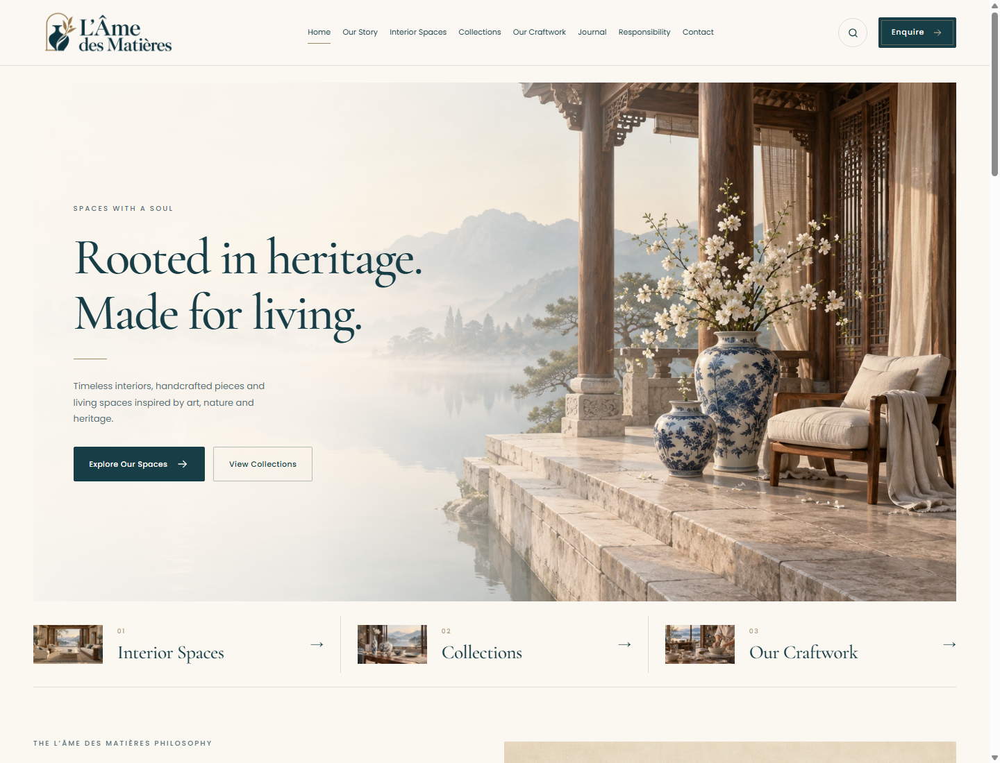
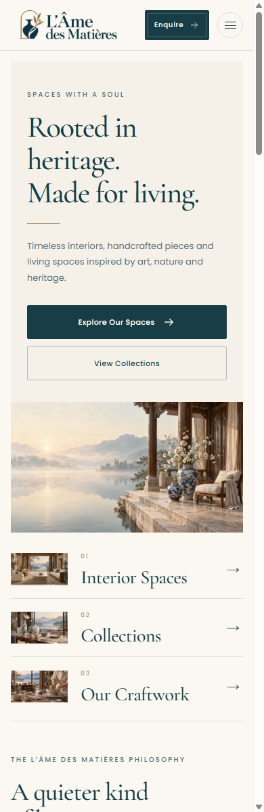
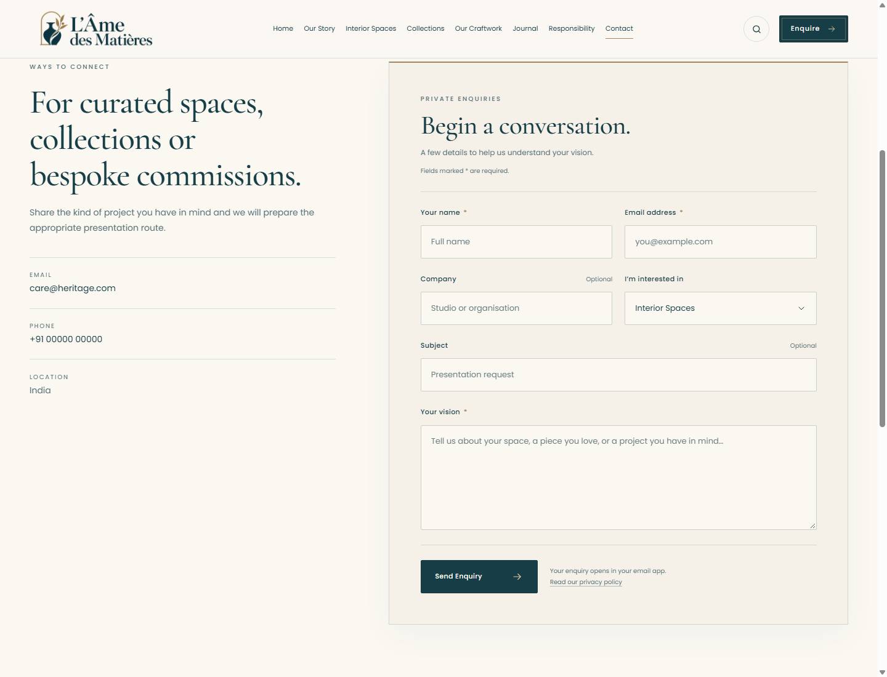
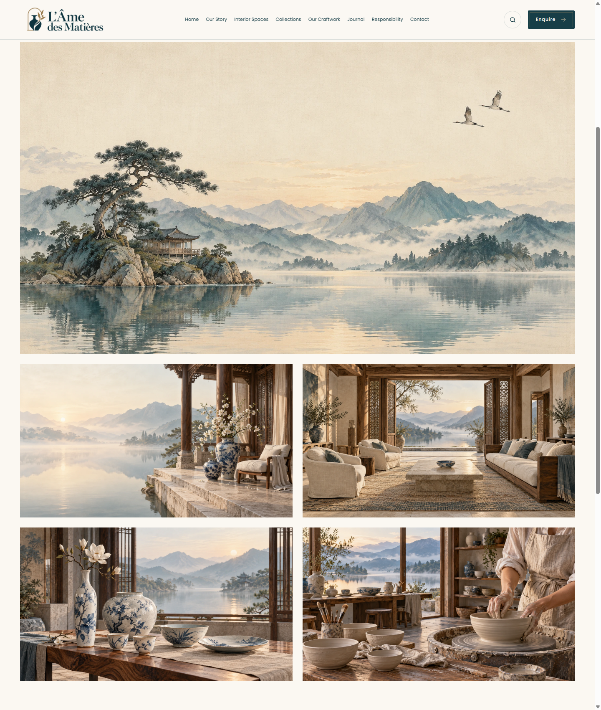

# L’Âme des Matières

**Considered interiors, collectible objects and the art of living well.**

A responsive, 17-page website for a French-inspired interiors and craft atelier. The design combines warm cream backgrounds, petrol teal typography, antique gold details and lakeside imagery with an editorial layout.

Built with **HTML, CSS and vanilla JavaScript**. No framework, package installation or build step is required.

## Preview



*The homepage introduces the brand through architecture, porcelain and craftsmanship. Screenshots are captured from the actual website.*

<details>
<summary>View the mobile homepage</summary>

<p></p>

</details>

<details>
<summary>View the contact form</summary>



</details>

<details>
<summary>View the showcase gallery</summary>



</details>

## Features

- Responsive layouts with compact mobile navigation and a sticky header.
- Custom logo, favicons and a coordinated cream, teal and gold visual identity.
- Optimized WebP imagery displayed at its natural proportions.
- An editorial journal and a gallery of spaces, collections and craft.
- A themed enquiry form with labelled fields, autocomplete and required-field validation.
- A cinematic footer with a landscape video, playback control and reduced-motion support.
- Keyboard navigation, visible focus states, a skip link and accessible control labels.

## Run locally

From the repository root, start a local server with Python 3:

```sh
python -m http.server 4173 --bind 127.0.0.1
```

Open [http://127.0.0.1:4173](http://127.0.0.1:4173) in your browser. Press `Ctrl+C` in the terminal to stop the server.

You can also open `index.html` directly in a browser. A local server makes navigation and media checks more consistent. An internet connection is used for Google Fonts; system font fallbacks are included.

## Pages

| Area | Pages |
| --- | --- |
| Brand | [Home](index.html), [Our Story](about.html), [Responsibility](responsibility.html) |
| Interiors and collections | [Interior Spaces](interior-studios.html), [Collections](collections.html), [Luxury Décor](luxury-decor.html) |
| Craft | [Our Craftwork](craft.html), [Craft Story](craft-story.html), [Handcrafted Brands](handcrafted-brands.html) |
| Editorial and imagery | [Journal](journal.html), [Showcase](showcase.html), [Themes](themes.html), [Visual Direction](visual-direction.html) |
| Enquiries | [Contact](contact.html) |
| Legal | [Privacy](privacy.html), [Terms](terms.html), [Cookies](cookies.html) |

## Project structure

```text
.
├── index.html                 # Homepage
├── contact.html               # Enquiry form
├── showcase.html              # Image gallery
├── ...                        # Other HTML pages
├── assets/
│   ├── css/styles.css         # Shared styles and responsive layouts
│   ├── js/site.js             # Navigation, video controls and forms
│   ├── images/
│   │   ├── brand/             # Website logo and favicons
│   │   ├── generated/         # Generated artwork in WebP format
│   │   └── ...                # Referenced editorial images and poster
│   ├── media/                 # Footer landscape video
│   └── icons/                 # Social-icon attribution and license
├── docs/screenshots/          # README previews
├── .gitignore
└── README.md
```

## Customize

Edit page content directly in the HTML files. Shared colors are defined as CSS custom properties at the beginning of `assets/css/styles.css`:

| Token | Color | Use |
| --- | --- | --- |
| `--paper` | `#fbf8f2` | Main background |
| `--cream` | `#f5f1e9` | Panels and footer |
| `--ink` | `#173e47` | Text and primary buttons |
| `--gold` | `#9e8863` | Accents and details |

The type pairing is **Cormorant Garamond** for headings and **Poppins** for body text. Header and footer markup is repeated across the HTML pages, so apply shared content changes to every page.

Replace imagery inside `assets/images/` and update the corresponding `src`, `alt`, `width` and `height` attributes. Keep image dimensions proportional to the replacement artwork. The site uses a transparent WebP logo and PNG favicons in `assets/images/brand/`.

## Forms and contact details

The contact form and newsletter request currently prepare a **`mailto:` message in the visitor’s email application**. They do not send messages directly or store submissions. Their behavior is implemented in `assets/js/site.js`.

Before using the site for a real business:

- Replace `care@heritage.com` in the HTML pages and JavaScript with your contact address.
- Replace the placeholder phone number `+91 00000 00000` and the location where needed.
- Set real Instagram, Pinterest, YouTube and LinkedIn destinations; social links currently use `#`.
- Review the legal-page content for your business.
- Connect a form service or backend if you want submissions delivered without an email application.

## Hosting

The repository can be served directly by a static host, including GitHub Pages. Publish the repository root, with `index.html` as the entry page; no compilation or build command is needed. Relative paths support hosting under a repository subdirectory.

Include `assets/` when uploading or publishing. The `.gitignore` excludes local verification files, browser profiles, logs, editor settings, environment files and build caches while keeping website assets and README screenshots tracked.

## Credits

- Typography: Cormorant Garamond and Poppins, loaded through Google Fonts.
- Social marks: [Bootstrap Icons](https://github.com/twbs/icons), embedded as inline SVGs. Their MIT license is preserved in [assets/icons/LICENSE-bootstrap-icons.txt](assets/icons/LICENSE-bootstrap-icons.txt).
- The current brand identity and the artwork in `assets/images/generated/` include AI-generated imagery.

The Bootstrap Icons license applies to those icons. It does not grant a license for the rest of this project.
